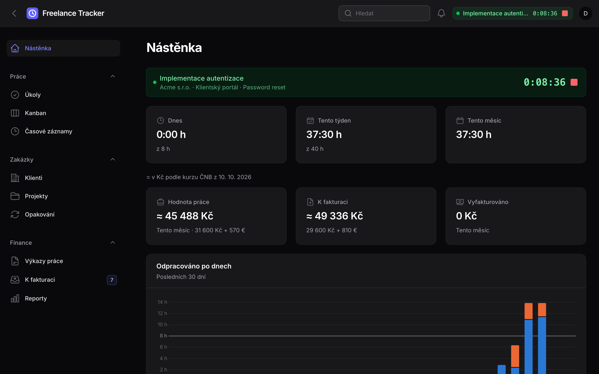
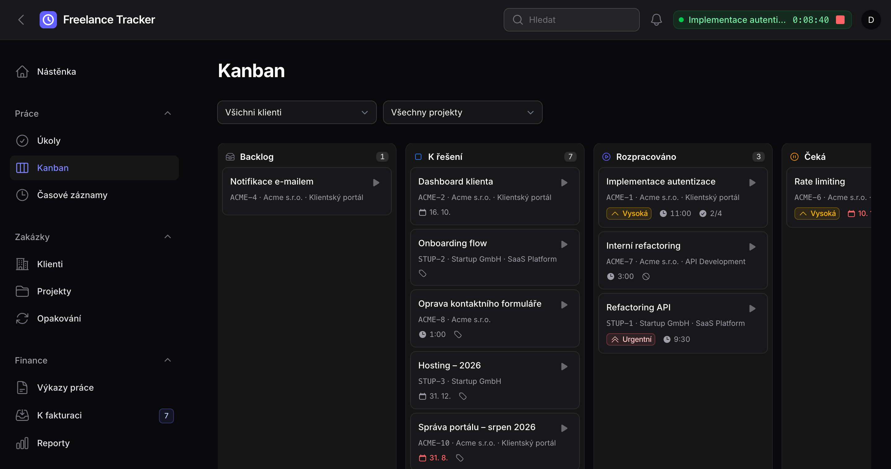
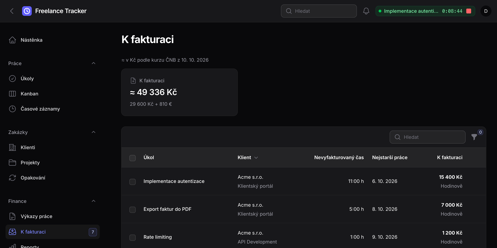

<h1 align="center">Freelance Tracker</h1>

<p align="center">
  Self-hosted time tracking and billing for a freelancer. Laravel 13, Filament 5, PostgreSQL 18.
</p>

<p align="center">
  <a href="https://github.com/musilondrej/freelance-tracker/actions/workflows/ci.yml"></a>
  <a href="LICENSE"></a>
</p>

<p align="center">
  
</p>

A single-user app: it tracks work and prepares statements of work. Invoices are issued elsewhere (Fakturoid). The UI is in Czech.

## Features

- Clients, projects with budgets, tasks with checklists and keys like `ACME-12`.
- Kanban board with drag and drop.
- Global timer and manual time entries.
- Hourly, fixed-price and non-billable work.
- Recurring tasks, e.g. monthly maintenance or yearly hosting.
- "To invoice" list and statements of work with PDF export.
- Reports per period, client and project. CSV exports.
- In-app and e-mail alerts.

<p align="center">
  
  
</p>

## Quick start

Requires only Docker. Run PHP, Composer and npm through Sail, never on the host: `node_modules` built on macOS lacks the Linux native bindings Vite needs in the container.

```bash
docker run --rm -u "$(id -u):$(id -g)" -v "$(pwd):/var/www/html" -w /var/www/html laravelsail/php84-composer:latest composer install --ignore-platform-reqs
cp .env.example .env
vendor/bin/sail up -d
vendor/bin/sail artisan key:generate
vendor/bin/sail artisan migrate
vendor/bin/sail npm install
vendor/bin/sail npm run build
vendor/bin/sail artisan make:filament-user
```

Open <http://localhost:8080>.

Demo data (local only, account `demo@example.com` / `password`):

```bash
vendor/bin/sail artisan migrate:fresh --seed --seeder=DemoSeeder
```

## Development

```bash
vendor/bin/sail composer check   # Pint, Rector, PHPStan, PHPUnit
vendor/bin/sail composer lint    # fix code style
```

## Docs

- [Code map](docs/map.md)
- [Architecture](docs/architecture.md)
- [Database](docs/database.md)
- [Time tracking](docs/time-tracking.md)
- [Billing](docs/billing.md)
- [Development](docs/development.md)

## Security

Report vulnerabilities privately, see [SECURITY.md](SECURITY.md). Contributions: [CONTRIBUTING.md](CONTRIBUTING.md).

## License

[MIT](LICENSE)
